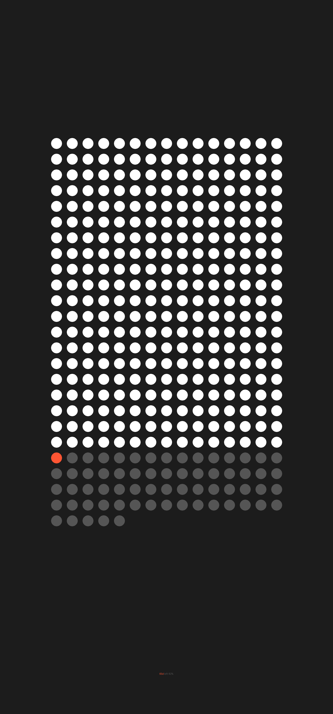

# Life Calendar

> A minimalist, premium year-in-progress wallpaper for Android and iOS. 365 dots tracking the passage of time, auto-updating at local midnight in pure jet black.



## ✨ Highlights

- **365 Dots Grid (366 on Leap Years)**: Every day of the year is represented as an elegant dot.
  - ⚪ **White**: Completed days
  - 🟠 **Orange (`#FF5533`)**: Today
  - ⚫ **Dark Grey (`#555555`)**: Remaining days
- **Model-Wise Exact Fit**: Dynamically queries the display resolution of any device (iPhone 16 Pro Max, S24 Ultra, Pixel, iPad, etc.) to render pixel-perfect wallpapers without scaling artifacts or blur.
- **Orientation Adaptive**: Automatically optimizes layout:
  - **Portrait**: 15 columns × 25 rows
  - **Landscape**: 25 columns × 15 rows
- **Local Midnight Auto-Update**: Triggers automatically at **12:00:00 AM in the device's local time zone** (not UTC). Reschedules automatically on timezone or daylight savings changes.
- **Dynamic 2026 – 2031+ Engine**: Works out-of-the-box for any year without hardcoded dates, seamlessly handling leap years (e.g. 2028 with 366 days).
- **Lock & Home Screen Sync**: Updates both the lock screen and the home screen.
- **Apple Jet Black Aesthetic**: Premium OLED jet black styling paired with San Francisco typography.
- **Zero Bloat & Battery Friendly**: A single exact alarm wakes once every 24 hours at 00:00:05, sets the wallpaper, and immediately returns to deep sleep.

---

## 🌐 Landing Page & Web Preview

The repository includes a ready-to-deploy static landing page at [`index.html`](index.html):
- **Live Interactive Phone Mockup**: Renders today's exact progress in real time with interactive hover dates.
- **Year Inspector**: Preview any year from 2026 through 2031+ (including 2028 leap year).
- **1-Click Wallpaper Generator**: Generates and downloads the current day's high-res 4K retina wallpaper directly in the browser.
- **Deployable to GitHub Pages**: Push to `main` and enable GitHub Pages in Settings → Pages.

---

## 📱 Android App

- **Direct Download**: [`LifeCalendar.apk`](LifeCalendar.apk) (also in [`downloads/LifeCalendar.apk`](downloads/LifeCalendar.apk))
- **Source Code**: [`android-app/`](android-app/)
- **Installation**:
  1. Download [`LifeCalendar.apk`](LifeCalendar.apk) on your Android phone.
  2. Open and tap **Install**.
  3. Launch the app and tap **Apply Wallpaper**.
  4. Auto-updates will trigger nightly at 12:00 AM local time.

---

## 🍏 iOS / iPhone

- **SwiftUI & WidgetKit Project**: [`ios-app/`](ios-app/)
- **Lock Screen / Home Screen Widget**: Uses native `WidgetKit` `TimelineProvider` scheduled for local midnight (`.after(nextMidnight)`).
- **Apple Shortcuts Midnight Automation**:
  1. Open the built-in **Shortcuts** app on iPhone.
  2. Go to the **Automation** tab → **New Automation**.
  3. Select **Time of Day** → **12:00 AM**, **Daily**, and check **Run Immediately**.
  4. Action: **Set Wallpaper** with the Life Calendar photo.

---

## 🐍 Python Wallpaper Script

Generate the wallpaper locally anytime with Python:

```bash
python3 life_calendar.py
# Or with uv:
uv run --with pillow python3 life_calendar.py
```
Output saved to [`output/life_calendar.png`](output/life_calendar.png).

---

## 📄 License
MIT License.
